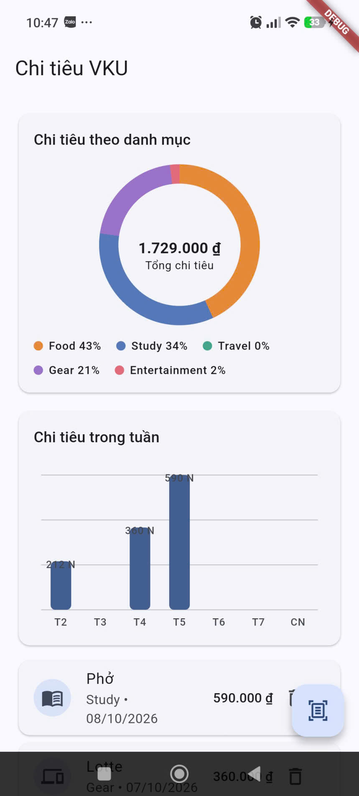
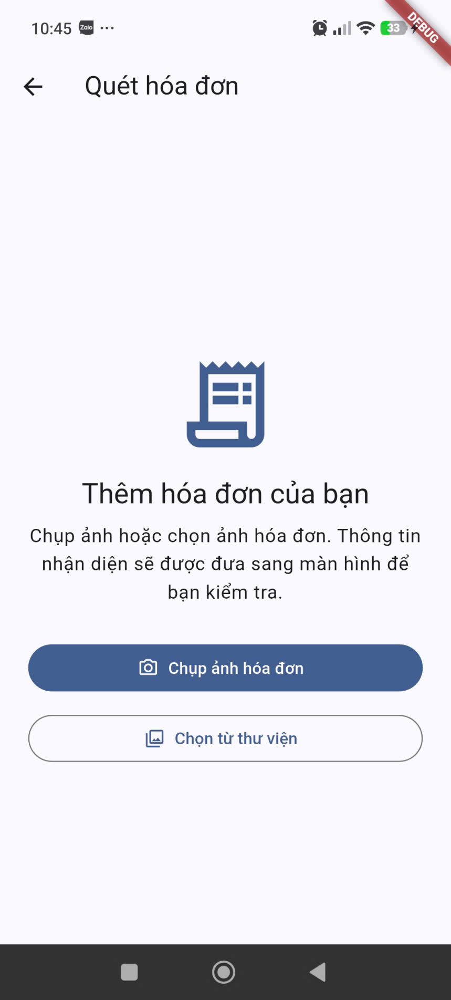
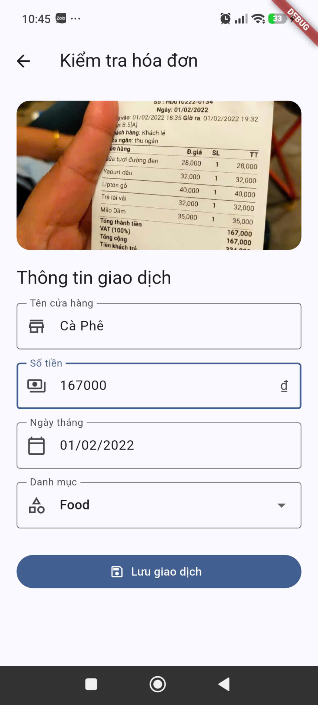
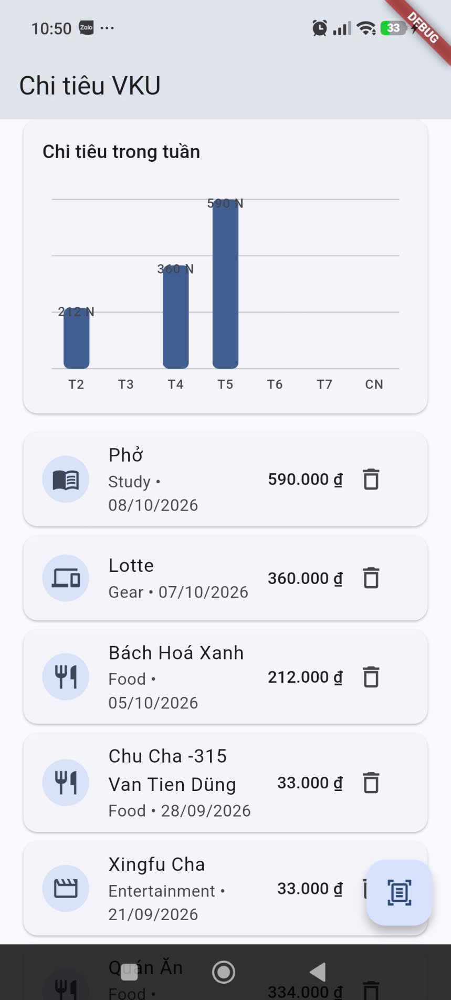

# MINI-PROJECT 3 REPORT

**Course:** Cross-Platform Mobile App Development (VKU)  
**Mini-Project Title:** OCR Expense Tracker & Receipt Parser
**Team / Student Name:** Dư Thị Như Yến  
**Submission Date:** 08/10/2026

### 1. THÔNG TIN CHUNG

- **Team Members:**
  1. Dư Thị Như Yến — Student ID: 23IT328 — Role: Full-stack Hybrid Mobile Developer — Contribution: 100%
- **🔗 Live Demo URL:** https://drive.google.com/file/d/1laAJrszUR92uNMo65kqf4n_sCcixLhCS/view?usp=sharing
- **💻 GitHub Repository:** https://github.com/NhuYen-jpg/Capacitator---View-Survey
- **🎥 Video Demo (Optional):** https://drive.google.com/file/d/13lKjAHDGpyi3K9_uF-MLmtsxmPLld8XK/view?usp=sharing

### 2. FEATURE IMPLEMENTATION CHECKLIST

|  #  | Required Feature                             |   Status    | Implementation Details & Acceptance Level                                                                                                                                    |
| :-: | -------------------------------------------- | :---------: | ---------------------------------------------------------------------------------------------------------------------------------------------------------------------------- |
|  1  | Camera Capture & Image Cropping              | ✅ Complete | Tích hợp image_picker cho phép chụp hóa đơn qua camera hoặc chọn từ bộ sưu tập ảnh, có xem trước và framing overlay.                                                         |
|  2  | On-Device Text Recognition & Regex Engine    | ✅ Complete | Sử dụng google_mlkit_text_recognition xử lý OCR offline dưới 100ms. Hệ thống bộ lọc Regex heuristic tự động phân tích Tổng tiền (đ, VND), Ngày (DD/MM/YYYY) và Tên cửa hàng. |
|  3  | Interactive Review & Manual Editing          | ✅ Complete | Màn hình Review xác nhận dữ liệu sau OCR, hỗ trợ form validation (TextFormField) để chỉnh sửa thủ công trước khi lưu.                                                        |
|  4  | Local Database Persistence                   | ✅ Complete | Lưu trữ dữ liệu giao dịch và đường dẫn ảnh hóa đơn bền vững bằng sqflite (SQLite), hỗ trợ phân loại danh mục (Food, Study, Travel, Gear, Entertainment).                     |
|  5  | Custom Canvas Visualizations (CustomPainter) | ✅ Complete | Tự vẽ biểu đồ Donut phân bố danh mục chi tiêu kèm AnimationController và biểu đồ cột hàng tuần trực tiếp trên Canvas, không dùng thư viện ngoài.                             |

---

### 3. TECHNICAL ARCHITECTURE & PROJECT STRUCTURE

#### 3.1. Cấu trúc dự án

```text
vku_expense_ocr/
├── android/
│   └── app/
│       ├── build.gradle.kts
│       └── src/main/AndroidManifest.xml
├── lib/
│   ├── main.dart
│   ├── models/
│   │   └── expense_item.dart
│   ├── providers/
│   │   └── expense_provider.dart
│   ├── routes/
│   │   └── app_router.dart
│   ├── screens/
│   │   ├── home_screen.dart
│   │   ├── scan_screen.dart
│   │   └── review_screen.dart
│   ├── services/
│   │   ├── database_helper.dart
│   │   ├── ocr_service.dart
│   │   └── receipt_parser.dart
│   └── widgets/
│       └── custom_charts.dart
├── test/
│   ├── custom_charts_test.dart
│   ├── receipt_parser_test.dart
│   └── widget_test.dart
├── pubspec.yaml
└── REPORT.md
```

#### 3.2. Vai trò các thành phần

| Thành phần                        | Trách nhiệm                                                                                   |
| --------------------------------- | --------------------------------------------------------------------------------------------- |
| `models/expense_item.dart`        | Mô hình giao dịch chi tiêu và chuyển đổi dữ liệu qua `toMap()` / `fromMap()` cho SQLite.      |
| `services/ocr_service.dart`       | Tạo `InputImage` từ đường dẫn ảnh, gọi ML Kit Text Recognition và trả về văn bản nhận dạng.   |
| `services/receipt_parser.dart`    | Phân tích văn bản OCR theo heuristic/Regex để tạo dữ liệu merchant, amount và date ban đầu.   |
| `services/database_helper.dart`   | Quản lý mở SQLite, tạo bảng `expenses`, migration và các thao tác insert, get all, delete.    |
| `providers/expense_provider.dart` | `AsyncNotifier` điều phối tải dữ liệu và đồng bộ thay đổi từ database tới giao diện Riverpod. |
| `routes/app_router.dart`          | Khai báo điều hướng GoRouter cho `/` (Home), `/scan` (Scan) và `/review` (Review).            |
| `screens/`                        | Cung cấp dashboard, chọn/chụp hóa đơn và form xác nhận giao dịch.                             |
| `widgets/custom_charts.dart`      | Vẽ donut chart và weekly bar chart bằng `CustomPainter`.                                      |

#### 3.3. Luồng xử lý dữ liệu (State Management & Transaction Lifecycle)

1. **Capture & OCR Execution**  
   Người dùng chọn **Chụp ảnh hóa đơn** hoặc **Chọn từ thư viện**. `image_picker` trả về ảnh cùng `imagePath`; ứng dụng tạo `OcrService`, gửi ảnh cho Google ML Kit Text Recognition trên thiết bị và nhận `rawText`. Sau xử lý, recognizer được đóng để giải phóng tài nguyên. Trong thời gian này màn hình hiển thị trạng thái đang nhận diện.

2. **Heuristic Parsing**  
   `ReceiptParser` nhận `rawText`, lấy dòng đầu tiên không rỗng làm merchant, dò ngày theo `DD/MM/YYYY` hoặc `DD-MM-YYYY`, và tìm số tiền. Bộ phân tích ưu tiên số tiền trên dòng có nhãn tổng (ví dụ `Total`, `Tổng cộng`, `Thanh toán`); nếu không thấy nhãn phù hợp, nó dùng kết quả khớp heuristic cuối cùng. Kết quả được gói trong `ExpenseItem` và giữ lại đường dẫn ảnh.

3. **Interactive Review**  
   GoRouter chuyển `ExpenseItem` tạm thời qua `extra` tới `/review`. Form được điền bằng dữ liệu nhận diện để người dùng kiểm tra và sửa merchant, amount, date và category. Validator ngăn lưu tên cửa hàng rỗng, số tiền không hợp lệ/không dương hoặc ngày không tồn tại.

4. **Local Database & Reactive UI (Riverpod)**  
   Khi người dùng nhấn **Lưu giao dịch**, Review gọi `ExpenseNotifier.addExpense()`. Notifier ghi bản ghi qua `DatabaseHelper`/SQLite, đọc lại danh sách và phát `AsyncData` mới. Home đang theo dõi `expenseProvider` nên danh sách và biểu đồ được cập nhật. Nếu thao tác database gặp lỗi, giao diện báo lỗi thay vì giả lập lưu thành công.

### 4. EMPIRICAL EVIDENCE & SCREENSHOTS

#### Screenshot 1: Trang chủ Dashboard & Biểu đồ CustomPainter



_Mô tả:_ Dashboard hiển thị các giao dịch đã lưu, tổng chi tiêu, donut chart phân bổ theo Food/Study/Travel/Gear/Entertainment và weekly bar chart. Có thể dùng dữ liệu mẫu đã nhập qua luồng Review để các biểu đồ có tỷ lệ và cột khác 0.

#### Screenshot 2: Chụp ảnh hóa đơn & Xử lý OCR



_Mô tả:_ Minh họa thao tác chụp hóa đơn bằng camera hoặc chọn ảnh trong thư viện, tiếp theo là trạng thái nhận diện đang chạy. Nếu trình bày cả kết quả OCR, cần dùng một hóa đơn thử nghiệm rõ nét và không chứa dữ liệu cá nhân nhạy cảm.

#### Screenshot 3: Interactive Review & Form Validation



_Mô tả:_ Form Review chứa merchant, số tiền, ngày và danh mục được trích xuất để người dùng chỉnh sửa. Có thể chụp thêm trạng thái validator khi thiếu merchant, số tiền không hợp lệ hoặc nhập ngày không tồn tại để minh họa kiểm tra đầu vào.

#### Screenshot 4: Biểu đồ cột Weekly Bar Chart



_Mô tả:_ Tập trung vào biểu đồ cột tổng hợp chi tiêu từ thứ Hai đến Chủ nhật.

### 5. TECHNICAL CHALLENGES & RESOLUTIONS

#### Bottleneck 1: Độ nhiễu và đa dạng định dạng tiền tệ trên hóa đơn Việt Nam

Hóa đơn có thể ghi số tiền theo nhiều dạng như `150,000 VND`, `150.000 đ` hoặc `150000`; OCR cũng có thể nhầm dấu chấm/phẩy, xuống dòng hoặc nhận nhiều con số như mã sản phẩm, số lượng và thành tiền. Nếu chỉ lấy chuỗi số cuối cùng một cách máy móc, ứng dụng có thể nhận nhầm subtotal hoặc số không liên quan.

**Giải pháp trong phiên bản hiện tại:**

- Dùng Regex nhận các nhóm số có dấu phân tách và các hậu tố tiền tệ thông dụng (`VND`, `VNĐ`, `đ`).
- Loại ngày tháng khỏi phần dò amount để tránh lấy nhầm ngày làm số tiền.
- Ưu tiên số tiền trên dòng có nhãn tổng như `Total`, `Tổng cộng`, `Thanh toán` hoặc `Phải trả`; chỉ dùng fallback heuristic khi không có nhãn.
- Chuẩn hóa dấu phân tách trước khi chuyển sang kiểu số và hiển thị kết quả trong form Review để người dùng sửa trước khi lưu.

**Giới hạn còn lại:** Hóa đơn không theo bố cục phổ biến, OCR kém hoặc nhiều số tiền trên cùng dòng vẫn có thể khiến heuristic chọn nhầm. Parser hiện chưa được huấn luyện theo mẫu riêng của từng cửa hàng; review thủ công là bước kiểm soát cuối.

#### Bottleneck 2: Native dependencies của Google ML Kit trên Android Gradle

Plugin Flutter có phần native Android và phụ thuộc vào phiên bản Android SDK, `minSdkVersion`, NDK, Gradle và JDK tương thích. Xung đột phiên bản có thể làm Gradle sync hoặc build APK thất bại, dù mã Dart phân tích thành công.

**Cách cấu hình/giải quyết được áp dụng trong repository:**

- `android/app/build.gradle.kts` lấy `compileSdk`, `minSdk`, `targetSdk` từ cấu hình Flutter bằng `flutter.compileSdkVersion`, `flutter.minSdkVersion`, `flutter.targetSdkVersion`, thay vì ghim cứng giá trị cục bộ.
- NDK được lấy từ `flutter.ndkVersion`; Java và Kotlin target dùng JVM 17 theo cấu hình dự án.
- Khi cập nhật plugin, cần kiểm tra yêu cầu Android tối thiểu của phiên bản plugin, chạy Gradle sync và build Android Release trên môi trường Android SDK phù hợp. Nếu plugin yêu cầu `minSdk` cao hơn mặc định Flutter, cần nâng `minSdk` có chủ đích và kiểm tra thiết bị mục tiêu trước khi phát hành.

**Trạng thái xác minh:** Cấu hình hiện tại dùng phiên bản SDK/NDK do Flutter quản lý. Không ghi nhận một thay đổi riêng để ghim phiên bản hoặc một log lỗi Gradle cụ thể trong báo cáo này; cần xác nhận build Release thành công trên môi trường phát hành trước khi nộp APK.

### 6. TESTING & QUALITY CHECKS

Các kiểm tra tự động hiện có trong repository:

| Kiểm tra                        | Phạm vi                                                                                                |
| ------------------------------- | ------------------------------------------------------------------------------------------------------ |
| `flutter analyze`               | Kiểm tra lỗi phân tích Dart và các cảnh báo trong dự án.                                               |
| `flutter test`                  | Chạy kiểm thử parser, widget điều hướng và render biểu đồ.                                             |
| `test/receipt_parser_test.dart` | Kiểm tra số tiền `150,000 VND`, `150.000 đ`, `150000`, ngày có dấu `/` và `-`, cùng ưu tiên nhãn tổng. |
| `test/custom_charts_test.dart`  | Kiểm tra donut chart và weekly bar chart được dựng, hiển thị chú giải danh mục.                        |
| `test/widget_test.dart`         | Kiểm tra điều hướng từ Home sang Scan.                                                                 |

> Kiểm thử widget không thay thế kiểm thử trên thiết bị thật. Trước khi phát hành, nên xác minh camera/gallery, quyền truy cập, OCR trên hóa đơn thực tế và persistence sau khi đóng/mở lại ứng dụng.

### 7. CONCLUSION

Mini-Project 3 xây dựng ứng dụng Flutter theo luồng chính của một expense tracker: chọn/chụp hóa đơn, nhận dạng chữ trên thiết bị, phân tích dữ liệu bằng Regex heuristic, xác nhận thông tin, lưu giao dịch trong SQLite và xem thống kê trực quan. Riverpod quản lý dữ liệu bất đồng bộ; GoRouter tổ chức điều hướng; các biểu đồ được tự vẽ bằng `CustomPainter`.

Các hạng mục cần hoàn thiện trước khi tuyên bố phạm vi đầy đủ gồm crop ảnh sau khi chọn/chụp, dark mode và xác minh bản Android Release/APK trên môi trường phát hành. Việc công khai các giới hạn này giúp kết quả báo cáo khớp với mã nguồn và minh chứng thực tế.
